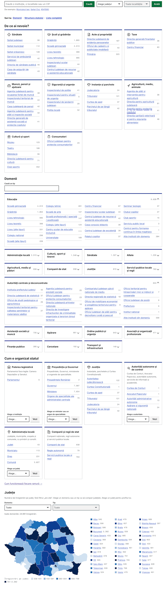

# org.gov2.ro

Explorer: **https://org.gov2.ro** (publicat cu `sh scripts/publish_pages.sh`).

Fă o listă a instituților publice din România. Adunăm cât mai multe detalii.

Va fi și input data (cu site-urile publice) pentru [gov2-ro/stiri](https://github.com/gov2-ro/stiri)

## Roadmap
### MVP
- [x] scrape [roepas](https://roepas.ro/ro/institutii)
- [x] look at alternate sources
- [x] consolidate data
- [x] integrate ANI "Declarații integritate" (declaration counts, state-owned companies)
- [ ] re-export the two capped ANI county groups (full tail of rare names)
- [~] resolve ANI-only records (state companies) to a CUI via the ONRC open data (first batch applied 2026-11-05; see `docs/BACKLOG.md`)

## Pipeline

```sh
python3 scripts/lookup_status.py       # -> data/lookup/status.csv (status of the CUIs that ANAF does not list; MF files)
uv run scripts/consolidate.py          # -> data/consolidated/ (institutii.csv/json, metadata.json, rows.json)
python3 -m http.server                 # then open http://localhost:8000/explorer/
```

Sources it reads: the ANAF list (backbone, `docs/reference/`), the ROePAS scrape (`data/roepas/`, `scripts/scrape_roepas.py`),
the Registrul PDF extraction (`docs/reference/`) and the ANI exports (`data/declaratii-integritate/`).

Attribution: the tax IDs (CUI) that `curation/identities.csv` and `curation/merges.csv` give to ANI-only records come from the
open dataset "Firme înregistrate la Registrul Comerțului până la data de 19.10.2026" of the Oficiul Național al Registrului
Comerțului (ONRC), published on data.gov.ro under the licence [CC-BY-4.0](https://creativecommons.org/licenses/by/4.0/).
`scripts/onrc_candidates.py` matches the names; a person reviews the matches. The ONRC files are not in this repository.

Attribution: the columns `status`, `status_date` and `status_source`, and the county of some `S` records (`county_source` `status`), come from
the open dataset "Date de identificare plătitori actualizate iunie 2026" of the Ministerul Finanțelor, published on data.gov.ro under the
licence [CC-BY-4.0](https://creativecommons.org/licenses/by/4.0/). The snapshot date is 2026-06-11. `scripts/lookup_status.py` reads the
rows of public bodies and companies. It skips every row of a natural person. The MF files are not in this repository. The value `listat`
means only that the files list no dissolution of the body. It does not prove that the body is active.

### ANI exports (data/declaratii-integritate/)
Kibana Lens → "Top values of `institutie_id.keyword`" + "Count of records", filtered on a group of counties,
exported as CSV (`Lens Visualization [...].csv`). Kibana keeps at most 10,000 values per export, so:

- keep each export under 10,000 rows: split a county group until it is (8 counties at a time is a safe start);
  the script warns about any file that hit the cap;
- re-exporting a group in parts is fine: a value present in several files is counted once, so the old capped
  file can stay until the new ones are in.

### Alt sources
- have a look at [Lista_EP_portal_01102026](docs/reference/Lista_EP_portal_01102026.xlsx) - [sursa](https://extranet.anaf.mfinante.gov.ro/anaf/extranet/EXECUTIEBUGETARA/alte_rapoarte/alte_rapoarte2/!ut/p/a1/04_Sj9CPykssy0xPLMnMz0vMAfGjzOLdLTwMDC2DDbwsAk1MDBydTL0tnL38DA0MzIEKIpEVGJj5Wxg4Bhg4eZj5eRsZuBsRp98AB3A0IKQ_XD8KvxIzdAVYnAhWgMcNBbmhEQaZnooA9RNosw!!/dl5/d5/L2dBISEvZ0FBIS9nQSEh/)
- [gov.ro](https://gov.ro/ro/institutii)
- more lists in [gDrive](https://drive.google.com/drive/folders/1G49s2zBOwop208Ge17T6_1qXLQfU2kgd?usp=drive_link) to consult later




---

Copyright (c) 2026 [gov2.ro](https://gov2.ro)
Date reutilizabile conform [EUPL v1.2](https://joinup.ec.europa.eu/collection/eupl/eupl-text-eupl-12) (the "Licence")
